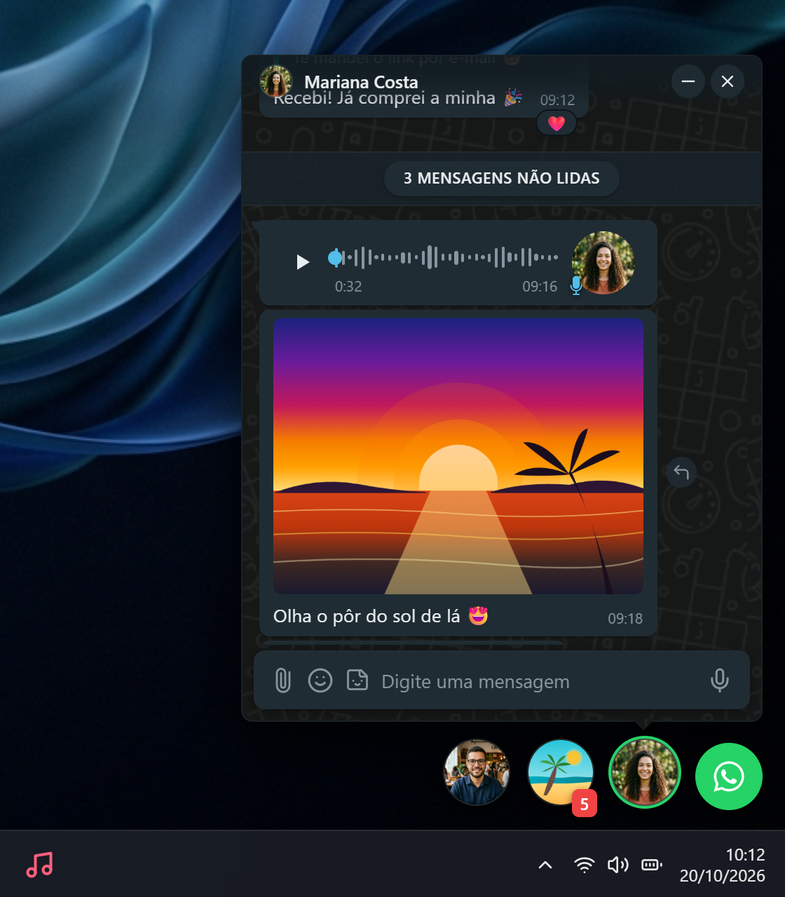

# ZapBolhas 💬✨
### *O WhatsApp que flutua. Onde o seu foco nunca é interrompido.*

<p align="center">
  
  
  
  
  
  
</p>

---


> **ZapBolhas** traz o conceito consagrado de *Chat Heads* flutuantes diretamente para a área de trabalho do Windows. Uma camada de software translúcida, inteligente e não obstrutiva que repousa sobre qualquer aplicativo — editor de código, navegador, planilhas ou jogos —, permitindo que você visualize e responda mensagens instantaneamente sem alternar janelas com `Alt + Tab`.

---

## 🌟 Uma Nova Filosofia de Mensagens no Desktop

*Trabalhar em múltiplas tarefas exige concentração. Alternar constantemente para uma janela pesada do WhatsApp quebra o fluxo de raciocínio. O ZapBolhas resolve isso com sutileza matemática.*

<table>
  <tr>
    <td width="33%" align="center">
      <h3>🫧 Invisível até ser chamado</h3>
      <p>Overlay com transparência total e <i>click-through</i> inteligente: o mouse clica livremente nos seus programas através da área vazia.</p>
    </td>
    <td width="33%" align="center">
      <h3>⚡ Respostas em Milissegundos</h3>
      <p>Abra chats em janelas compactas e dinâmicas que recolhem com apenas um clique ou atalho, mantendo sua produtividade no ápice.</p>
    </td>
    <td width="33%" align="center">
      <h3>🔒 Privacidade e Autonomia</h3>
      <p>Comunicação direta ponta a ponta com o protocolo oficial via biblioteca de automação web, sem servidores intermediários.</p>
    </td>
  </tr>
</table>

---

## 📸 Galeria de Experiência

### 1. Dock Flutuante & Notificações Dinâmicas
As conversas recentes ou com mensagens pendentes organizam-se automaticamente em uma elegante barra flutuante. Ícones redondos com fotos de perfil, contadores vibrantes de mensagens não lidas e transições suaves com física de molas (*spring physics*).

<p align="center">
  
</p>

---

### 2. Central de Conversas Instantânea
Acesse todas as conversas do seu WhatsApp em um popover translúcido com efeito acrílico escuro. Faça buscas instantâneas, visualize status de envio (`✓✓`), prévias de texto e fixações com zero lentidão.

<p align="center">
  
</p>

---

### 3. Janela de Conversa Completa & Interativa
Experiência completa de bate-papo sem abrir o navegador:
- Reprodução de áudios com **forma de onda visual interativa**.
- Fotos em alta resolução e visualização de mídias enviadas/recebidas.
- **Reações com emojis** diretamente nas bolhas de mensagem.
- Citações e respostas encadeadas fiéis ao aplicativo oficial.
- Barra superior retrátil com controles de minimizar, fechar e dados de presença.

<p align="center">
  
</p>

---

### 4. Grupos Otimizados & Menções Inteligentes com `@`
Em grupos corporativos ou comunitários com centenas de membros, a busca de contatos tradicional costuma travar ou sobrecarregar a interface. O ZapBolhas implementa:
- **Resolução de Contatos com Prioridade:** Prioriza nomes reais salvos na sua agenda em vez de apenas apelidos públicos desconhecidos.
- **Autocompletar Otimizado de `@`:** Limite inteligente com paginação em memória e filtragem instantânea conforme você digita.

| Conversa em Grupo | Menções com Autocomplete Filtrado |
|:---:|:---:|
|  |  |

---

### 5. Emojis, Figurinhas & Mídias em Detalhe
Expresse-se com a riqueza do WhatsApp tradicional sem perder espaço de tela:
- **Seletor Nativo de Emojis:** Categorias organizadas, busca rápida e navegação intuitiva.
- **Biblioteca de Figurinhas (*Stickers*):** Envio instantâneo de stickers favoritos e recentes.
- **Visualizador Lightbox:** Clique em qualquer imagem para abrir um visualizador focado com fundo escurecido e zoom.

| Seletor de Emojis | Gaveta de Figurinhas | Visualizador Lightbox |
|:---:|:---:|:---:|
|  |  |  |

---

### 6. Controles Rápidos, Autenticação e Configurações
- **Menu de Contexto no Botão Principal:** Clique com o botão direito na bolha mestra verde para **Recarregar a sessão** (útil após reconexões de rede), abrir as **Configurações**, **Deslogar** ou **Sair da aplicação**.
- **Autenticação Descomplicada:** Leitura de QR Code direta na janela de boas-vindas com renovação automática.
- **Preferências Customizáveis:** Escolha em qual monitor o dock deve ficar, ajuste a posição vertical, defina atalhos e comportamentos de notificação.

| Menu de Contexto | Conexão QR Code | Painel de Configurações |
|:---:|:---:|:---:|
|  |  |  |

---

## 🛠️ Arquitetura Técnica

```
┌────────────────────────────────────────────────────────┐
│                   Windows 11 Desktop                   │
│  ┌──────────────────────────────────────────────────┐  │
│  │     ZapBolhas Transparent Overlay Window         │  │
│  │  - win.setIgnoreMouseEvents(forward: true)       │  │
│  │  - frameless, alwaysOnTop, transparent, skipTask │  │
│  │                                                  │  │
│  │   ┌──────────────┐         ┌─────────────────┐   │  │
│  │   │  Chat Head   │         │ Active Chat     │   │  │
│  │   │  (Bubbles)   │         │ Window Popover  │   │  │
│  │   └──────┬───────┘         └────────┬────────┘   │  │
│  └──────────┼──────────────────────────┼────────────┘  │
│             │   IPC (Electron Context) │               │
│  ┌──────────▼──────────────────────────▼────────────┐  │
│  │       Electron Main Process (Node.js)            │  │
│  │  - Window Management & Multi-Monitor Detection   │  │
│  │  - Context Menus & Tray Integration              │  │
│  │  - whatsapp-web.js (Headless Chromium Engine)    │  │
│  └──────────────────────────────────────────────────┘  │
└────────────────────────────────────────────────────────┘
```

- **Pass-Through de Cliques Dinâmico:** O overlay ocupa a tela inteira com transparência nativa. Sempre que o cursor do mouse passa sobre uma bolha ou janela ativa, o renderer emite um evento IPC para ativar a captura de cliques (`setIgnoreMouseEvents(false)`). Ao sair, o evento desativa a captura, permitindo clicar nos aplicativos abaixo sem qualquer barreira.
- **Front-end Moderno:** Construído em **React 18** com tipagem estrita em **TypeScript**, estilização utilitária com **Tailwind CSS** e animações fluidas baseadas em física via **Framer Motion**.
- **Gerenciamento de Estado:** **Zustand** para gerenciamento ultraleve de chats ativos, bolhas ancoradas, unread badges e perfil de usuário.
- **Backend WhatsApp:** Alimentado pela consagrada biblioteca **whatsapp-web.js**, garantindo suporte completo a criptografia, envio de áudios, imagens, reações e grupos.

---

## 🚀 Como Começar

### Pré-requisitos
- **Node.js** (versão 18 ou superior)
- **npm** ou **yarn**
- **Google Chrome** instalado (para a engine do Chromium utilizada pelo WhatsApp Web)
- Sistema Operacional: **Windows 10** ou **Windows 11**

### Instalação

1. Clone o repositório:
```bash
git clone https://github.com/molobyte/zapbolhas.git
cd zapbolhas
```

2. Instale as dependências:
```bash
npm install
```

3. Inicie o ambiente de desenvolvimento:
```bash
npm run dev
```
> O comando inicia concorrentemente o servidor Vite e o processo principal do Electron. Uma janela transparente será aberta na sua área de trabalho.

4. Escaneie o **QR Code** com o aplicativo do WhatsApp no seu smartphone (*Aparelhos conectados > Conectar um aparelho*).

---

## 📦 Scripts Disponíveis

| Comando | Descrição |
|---|---|
| `npm run dev` | Inicia o Vite e o Electron em modo de desenvolvimento com Hot Reload |
| `npm run build` | Compila o código TypeScript do Electron e empacota o front-end via Vite |
| `npm run preview` | Executa o build compilado localmente em modo preview |
| `npm run typecheck` | Valida todos os tipos TypeScript do projeto sem emitir arquivos |

---

## ⌨️ Atalhos e Dicas

- **Clique simples na bolha:** Abre ou recolhe a janela de conversa correspondente.
- **Clique com o botão direito na bolha verde:** Exibe o menu de controle rápido com as opções **Recarregar**, **Configurações**, **Deslogar** e **Sair**.
- **Hover na barra superior do chat:** Revela os botões de controle para minimizar ou fechar a janela flutuante.
- **Digitar `@` em grupos:** Abre instantaneamente o seletor com pesquisa progressiva dos participantes do grupo, exibindo nomes salvos da sua agenda.

---

## 🛡️ Privacidade & Termos

Este projeto é um cliente desktop não oficial e de código aberto desenvolvido para fins educacionais e de conveniência de interface do usuário. Não possui afiliação, patrocínio ou endosso da Meta Inc. ou do WhatsApp. Todos os dados da sua conta permanecem estritamente armazenados na sua própria máquina local.

---

## 📄 Licença

Distribuído sob a licença **MIT**. Consulte o arquivo `LICENSE` para mais informações.

<p align="center">
  Desenvolvido com carinho por <a href="https://github.com/molobyte"><b>molobyte</b></a> 🚀
</p>
