# ZapBolhas 💬✨
### *O WhatsApp que flutua. Onde o seu foco nunca é interrompido.*

<p align="center">
  
  
  
  
  
  
</p>

---

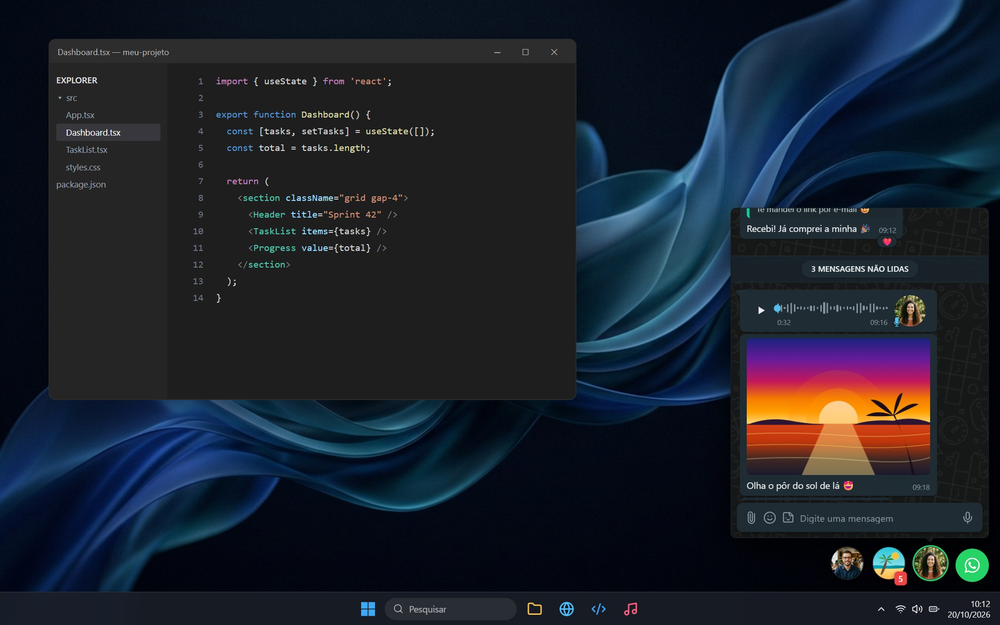

> **ZapBolhas** traz o conceito consagrado de *Chat Heads* flutuantes diretamente para a área de trabalho do Windows. Uma camada translúcida, inteligente e não obstrutiva que repousa sobre qualquer aplicativo — editor de código, navegador, planilhas ou jogos —, permitindo visualizar e responder mensagens instantaneamente sem alternar janelas com `Alt + Tab`.

---

## 🌟 Uma Nova Filosofia de Mensagens no Desktop

*Trabalhar em múltiplas tarefas exige concentração. Alternar constantemente para uma janela pesada do WhatsApp quebra o fluxo de raciocínio. O ZapBolhas resolve isso com sutileza matemática.*

<table>
  <tr>
    <td width="33%" align="center">
      <h3>🫧 Invisível até ser chamado</h3>
      <p>Overlay com transparência total e <i>click-through</i> inteligente: o mouse clica livremente nos seus programas através da área vazia.</p>
    </td>
    <td width="33%" align="center">
      <h3>⚡ Respostas em Milissegundos</h3>
      <p>Abra chats em janelas compactas e dinâmicas que recolhem com apenas um clique ou atalho, mantendo sua produtividade no ápice.</p>
    </td>
    <td width="33%" align="center">
      <h3>🔒 Privacidade e Autonomia</h3>
      <p>Comunicação direta ponta a ponta com o protocolo oficial via biblioteca de automação web, sem servidores intermediários.</p>
    </td>
  </tr>
</table>

---

## 📸 Galeria de Experiência & Funcionalidades

### 1. Dock Flutuante, Fixações & Mini Player de Áudio
As conversas recentes ou com mensagens pendentes organizam-se automaticamente em uma elegante barra flutuante:
- **Spring Physics:** Transições suaves baseadas em física de molas.
- **Conversas Fixadas:** Fixe contatos e grupos com indicador de alfinete (*pin*) verde que persistem entre sessões.
- **Mini Player na Bolha:** Ao minimizar uma conversa com áudio tocando, a reprodução continua sem interrupções! Um botão discreto de **Play/Pause** surge no topo da bolha do contato na dock. Ao reabrir, o chat rola suavemente com destaque visual direto na mensagem de áudio em reprodução.

<p align="center">
  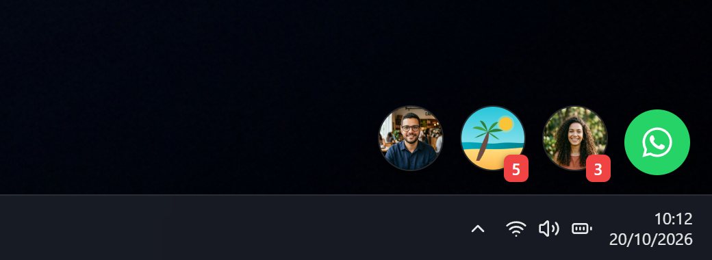
</p>

---

### 2. Central de Conversas Instantânea
Acesse todas as conversas do seu WhatsApp em um popover translúcido com efeito acrílico escuro:
- Busca instantânea com filtragem progressiva de contatos e grupos.
- **Ícones Clássicos de Confirmação:** `✓` cinza para enviado, `✓✓` cinza para entregue e `✓✓` azul para visualizado, atualizados em tempo real via IPC (`message_ack`).
- Prévias fiéis de texto, áudios com microfone verde e mídias.

<p align="center">
  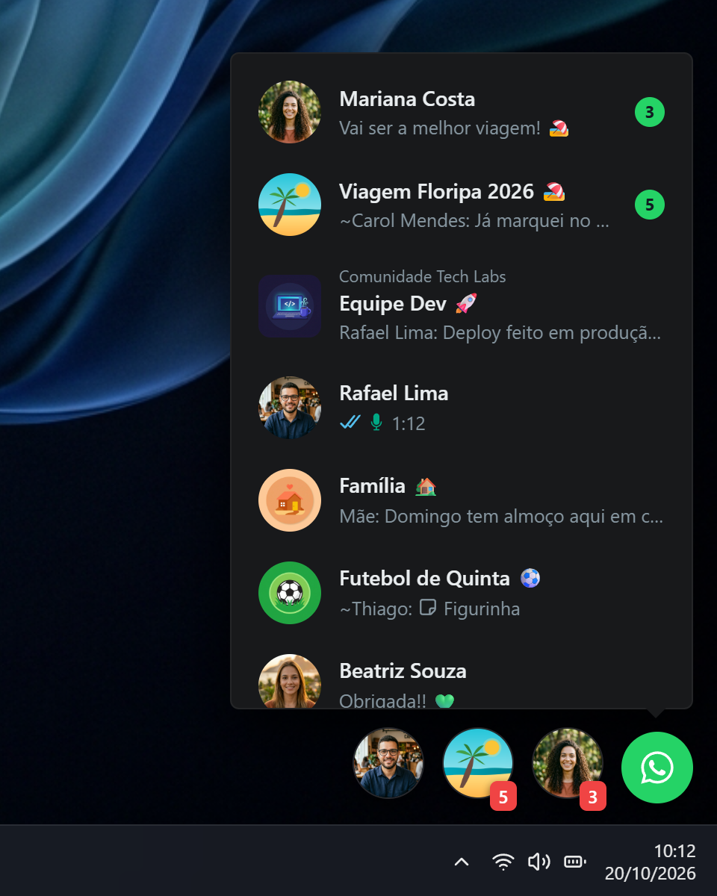
</p>

---

### 3. Janela de Conversa Interativa & Áudio com Velocidade
Experiência completa de bate-papo sem abrir o navegador:
- **Player de Áudio Avançado:** Forma de onda visual interativa (*waveform*), foto do remetente e seletor de velocidade (`1x`, `1.5x`, `2x`) com memória persistente.
- **Botão Flutuante de Rolagem Rápida:** Surge discretamente ao subir mais de 15 mensagens ou quando há novas mensagens não lidas abaixo, permitindo descer ao final com um único toque.
- **Banner de Mensagens Não Lidas:** Linha divisória destacada com contagem precisa de mensagens recebidas.
- **Fotos de Visualização Única:** Tratamento protegido com indicação clara.
- **Foco Restaurado:** O cursor retorna imediatamente ao campo *"Digite uma mensagem"* após o envio de fotos ou mídias.

| Player de Áudio & Citações | Banner de Mensagens Não Lidas |
|:---:|:---:|
| 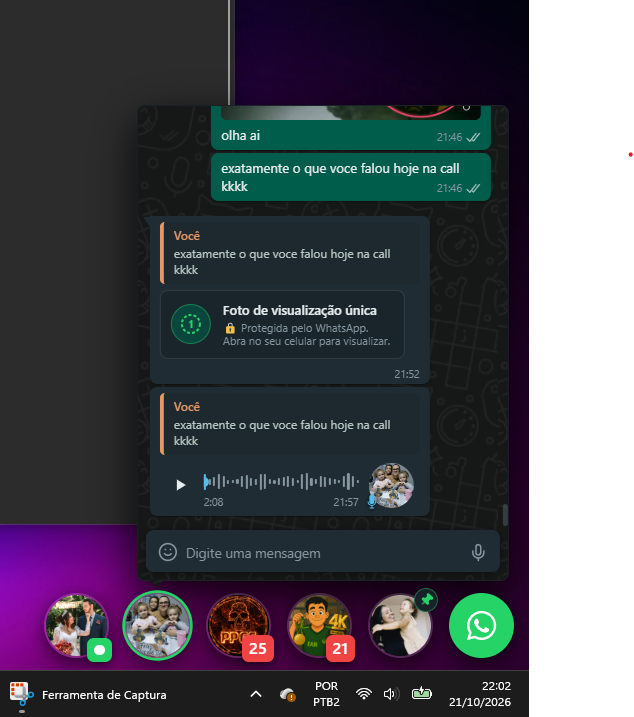 | 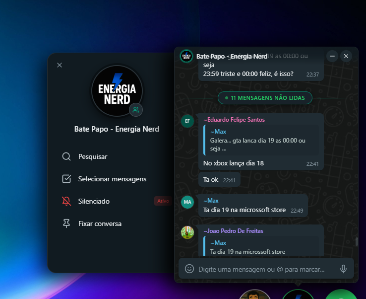 |

---

### 4. Sidebar Retrátil de Informações do Contato e Grupo
Acesse dados detalhados com a nova gaveta lateral que desliza suavemente por trás da conversa:
- **Para Grupos:** Descrição completa do grupo formatada, lista de participantes pesquisável sem limites com foto e badges de Administrador.
- **Para Contatos:** Foto em alta resolução, recados, número e ações rápidas.
- **Ações Imediatas:** Pesquisar no histórico, Selecionar mensagens para encaminhar, Silenciar e Fixar/Desfixar conversa.

<p align="center">
  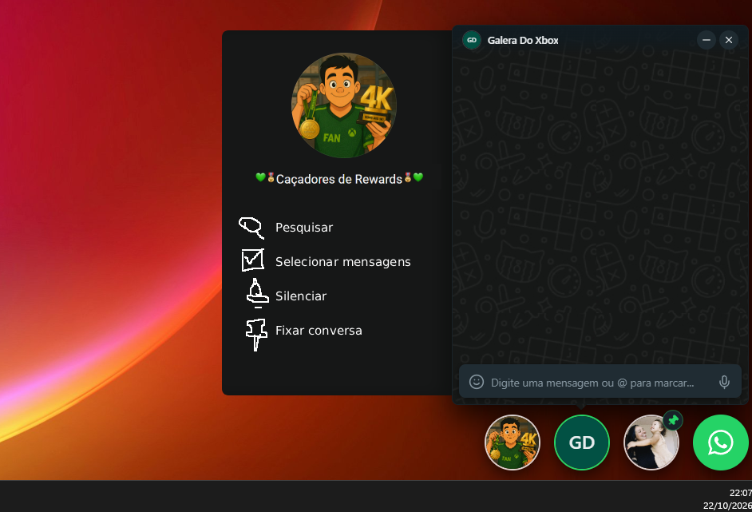
</p>

---

### 5. Encaminhamento Nativo de Mídias (Vídeos em HD & GIFs Animados)
Encaminhe mensagens individuais ou múltiplas com precisão:
- **Encaminhamento Nativo do WhatsApp:** Processamento direto através do motor do WhatsApp Web, sem recompressão ou perda de qualidade.
- **Vídeos em Resolução Original:** Preserva o arquivo MP4 em alta definição, tamanho e duração.
- **GIFs Animados:** Mantém a reprodução automática em loop contínuo e metadados nativos de GIF do WhatsApp.
- **Fotos, Áudios e Figurinhas:** Encaminhamento instantâneo mantendo legendas originais.

---

### 6. Grupos Otimizados & Menções Inteligentes com `@`
Em grupos corporativos ou comunitários com centenas de participantes:
- **Resolução Prioritária de Contatos:** Prioriza nomes reais salvos na sua agenda do celular em vez de números puros ou apelidos desconhecidos.
- **Autocompletar Otimizado de `@`:** Limite inteligente com paginação em memória e filtragem instantânea conforme você digita.

| Conversa em Grupo | Menções com Autocomplete Filtrado |
|:---:|:---:|
| 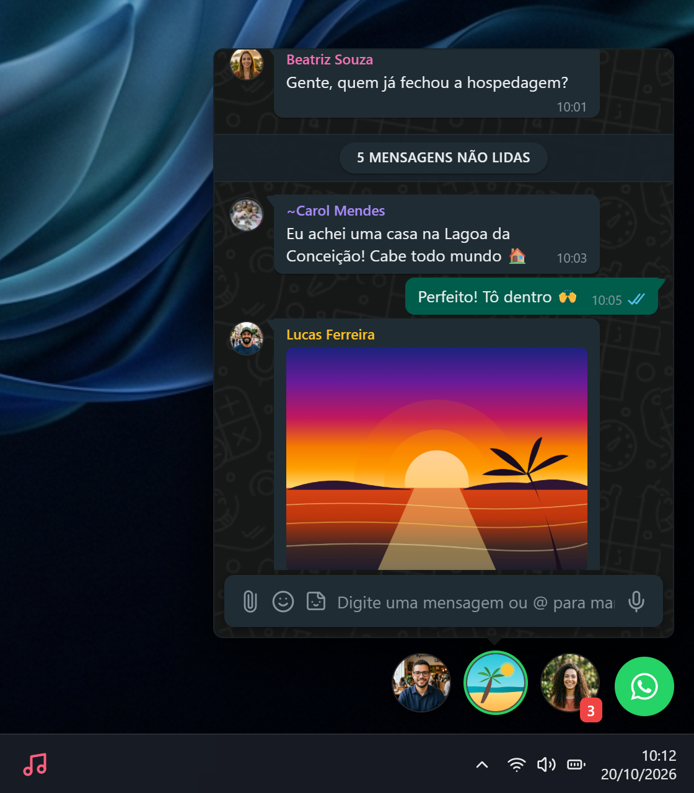 | 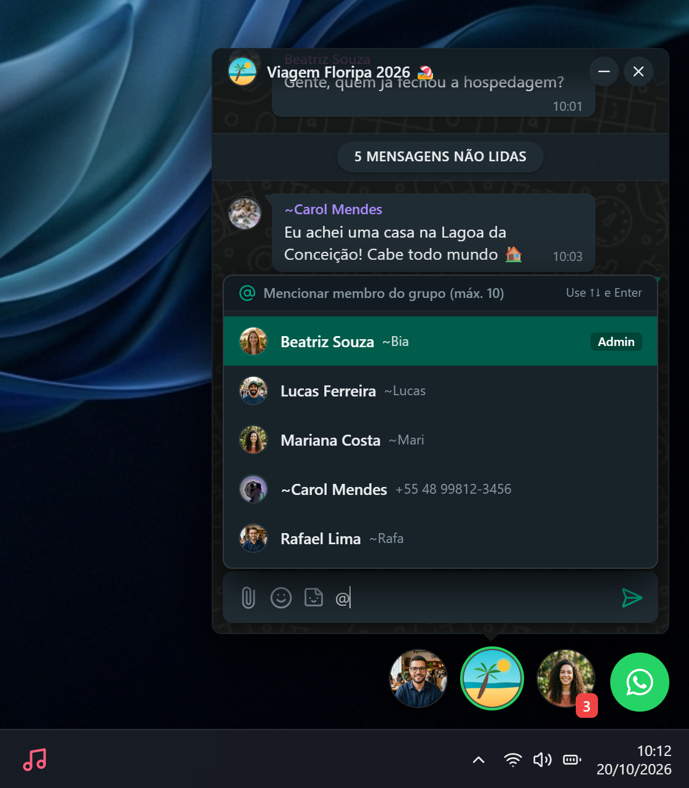 |

---

### 7. Emojis, Figurinhas & Visualizador Lightbox
Expresse-se com a riqueza do WhatsApp tradicional sem perder espaço de tela:
- **Seletor de Emojis:** Categorias organizadas, busca por texto e reações rápidas sobre mensagens.
- **Biblioteca de Figurinhas (*Stickers*):** Envio rápido de figurinhas recentes e favoritas.
- **Visualizador Lightbox:** Clique em qualquer imagem para abrir em tela cheia com zoom, download e abertura externa no seu visualizador padrão.

| Seletor de Emojis | Gaveta de Figurinhas | Visualizador Lightbox |
|:---:|:---:|:---:|
| 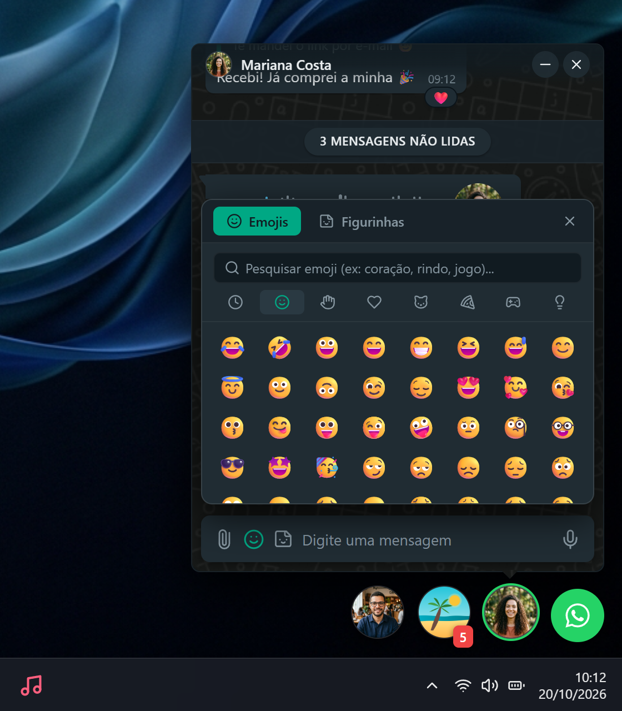 | 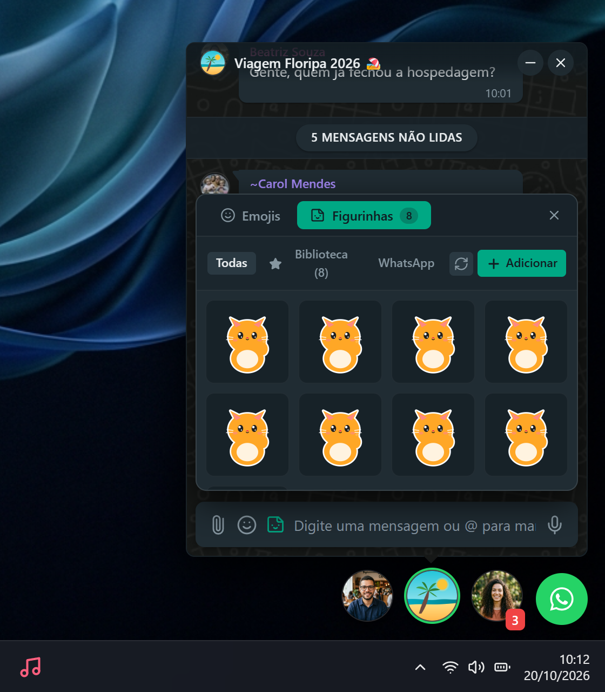 | 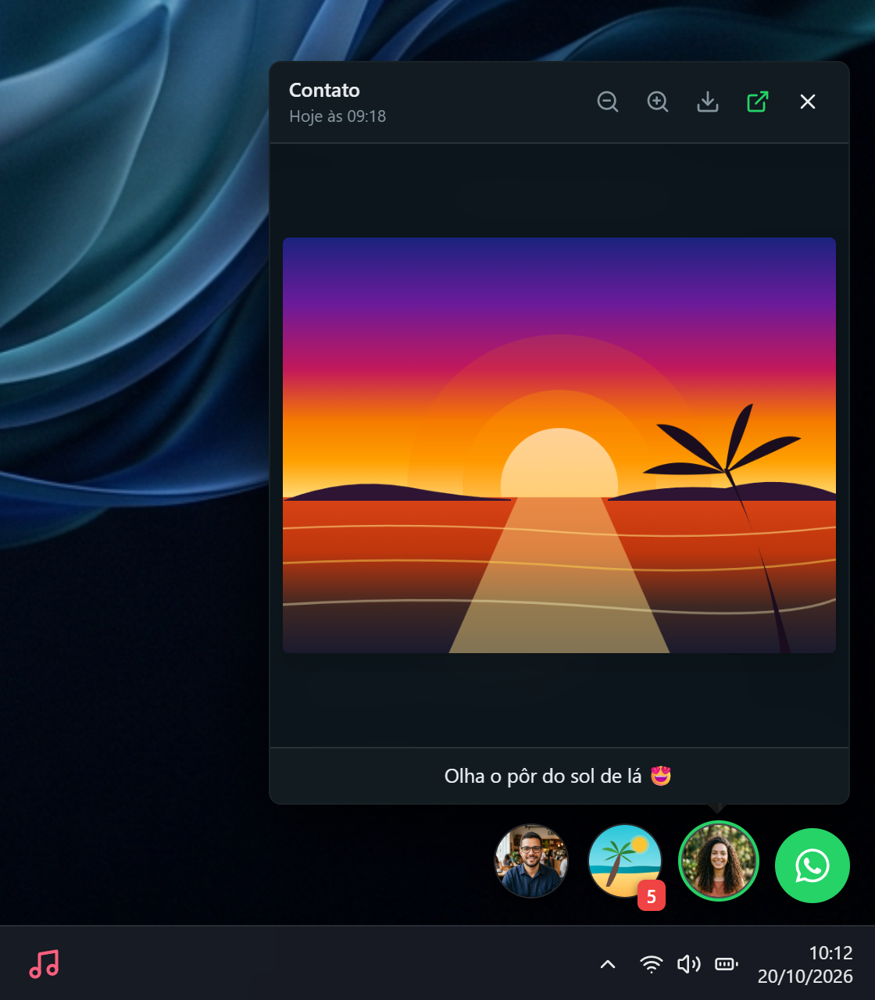 |

---

### 8. Painel de Configurações Completo & Personalização
Controle total sobre o comportamento e visual do aplicativo na sua área de trabalho:
- **Filtro ao Abrir o Zapbolhas:** Escolha entre abrir com *"Fixas + Não lidas (últimas 48h)"* ou *"Apenas as conversas fixadas"*, mantendo sua tela limpa e focada.
- **Borda das Bolhas Personalizável:** Escolha entre os modos *Padrão* (borda branca 80%), *Minimalista*, *Avançado* ou *Personalizada* com controle de cor, opacidade e espessura.
- **Sons de Notificação:** Sons diferenciados para contatos individuais e grupos, com *cooldown* inteligente (30s para usuário, 2min para grupo) e suporte a upload de áudios customizados (`.mp3`, `.wav`, `.ogg`).
- **Seleção de Monitor:** Em setups com múltiplos monitores, escolha exatamente em qual tela o dock e as janelas devem repousar.
- **Escala de Zoom:** Redimensione as bolhas de 65% a 145% para qualquer densidade ou resolução de tela.

| Painel de Configurações Atualizado | Conexão por QR Code | Menu de Controle Rápido |
|:---:|:---:|:---:|
| 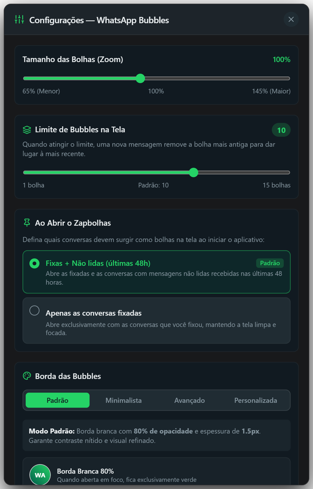 | 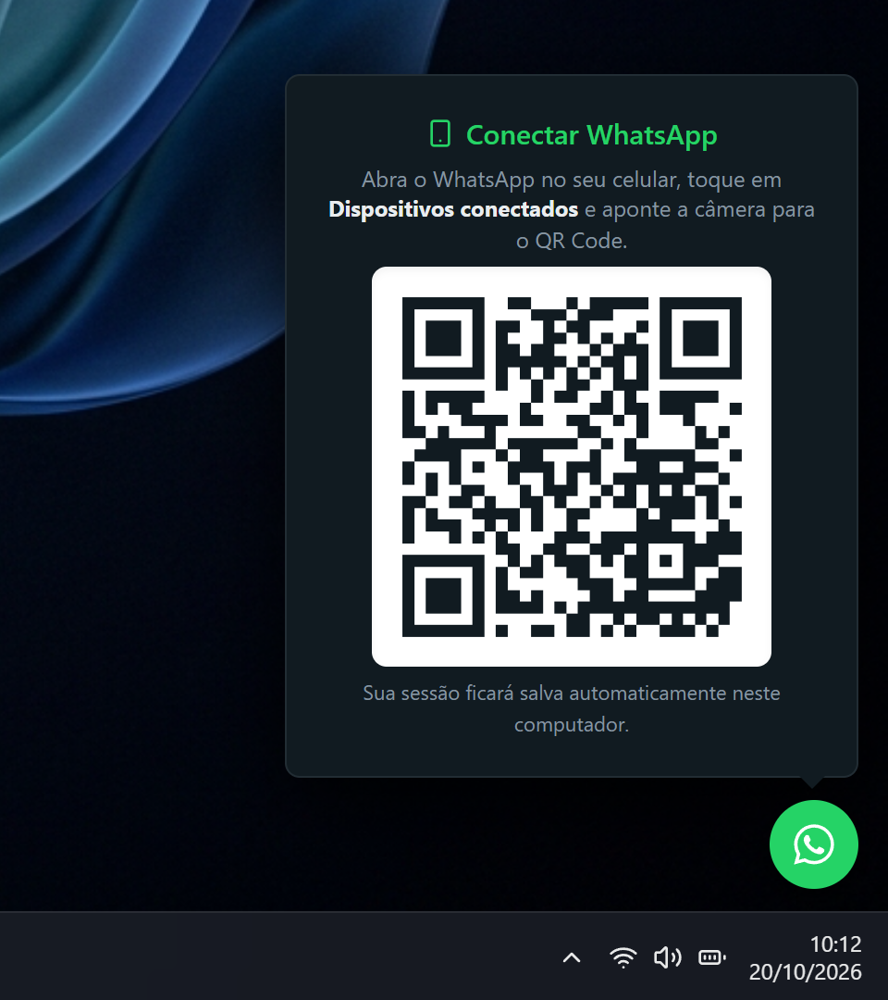 | 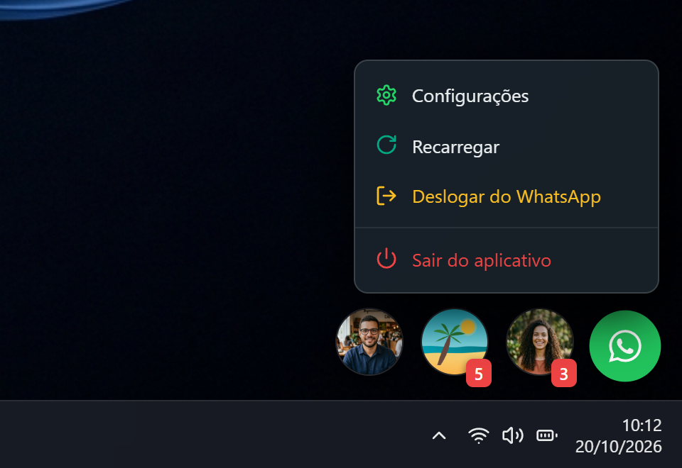 |

---

## 🛠️ Arquitetura Técnica

```
┌────────────────────────────────────────────────────────┐
│                   Windows 11 Desktop                   │
│  ┌──────────────────────────────────────────────────┐  │
│  │     ZapBolhas Transparent Overlay Window         │  │
│  │  - win.setIgnoreMouseEvents(forward: true)       │  │
│  │  - frameless, alwaysOnTop, transparent, skipTask │  │
│  │                                                  │  │
│  │   ┌──────────────┐         ┌─────────────────┐   │  │
│  │   │  Chat Head   │         │ Active Chat     │   │  │
│  │   │  (Bubbles)   │◄───────►│ Window Popover  │   │  │
│  │   └──────┬───────┘         └────────┬────────┘   │  │
│  └──────────┼──────────────────────────┼────────────┘  │
│             │   IPC (Electron Context) │               │
│  ┌──────────▼──────────────────────────▼────────────┐  │
│  │       Electron Main Process (Node.js)            │  │
│  │  - Multi-Monitor WorkArea Detection              │  │
│  │  - Native Forwarding (WAWebChatForwardMessage)   │  │
│  │  - Real-time Message ACK & Reaction Listeners    │  │
│  │  - whatsapp-web.js (Headless Chromium Engine)    │  │
│  └──────────────────────────────────────────────────┘  │
└────────────────────────────────────────────────────────┘
```

- **Pass-Through de Cliques Dinâmico:** O overlay ocupa a tela inteira com transparência nativa. Sempre que o cursor do mouse passa sobre uma bolha ou janela ativa, o renderer emite um evento IPC para ativar a captura de cliques (`setIgnoreMouseEvents(false)`). Ao sair, o evento desativa a captura, permitindo clicar nos aplicativos abaixo sem qualquer barreira.
- **Front-end Moderno:** Construído em **React 18** com tipagem estrita em **TypeScript**, estilização utilitária com **Tailwind CSS** e animações fluidas baseadas em física via **Framer Motion**.
- **Gerenciamento de Estado:** **Zustand** para orquestração ultraleve de chats ativos, bolhas ancoradas, badges de mensagens não lidas e preferências do usuário sincronizadas via IPC entre janelas.
- **Backend WhatsApp:** Alimentado pela biblioteca **whatsapp-web.js**, garantindo criptografia ponta a ponta, envio de áudios em formato de voz OGG Opus, stickers, mídias HD e grupos.

---

## 🚀 Como Começar

### Pré-requisitos
- **Node.js** (versão 18 ou superior)
- **npm** ou **yarn**
- **Google Chrome** instalado (para a engine do Chromium utilizada pelo WhatsApp Web)
- Sistema Operacional: **Windows 10** ou **Windows 11**

### Instalação

1. Clone o repositório:
```bash
git clone https://github.com/molobyte/zapbolhas.git
cd zapbolhas
```

2. Instale as dependências:
```bash
npm install
```

3. Inicie o ambiente de desenvolvimento:
```bash
npm run dev
```
> O comando inicia concorrentemente o servidor Vite e o processo principal do Electron. Uma janela transparente será aberta na sua área de trabalho.

4. Escaneie o **QR Code** com o aplicativo do WhatsApp no seu smartphone (*Aparelhos conectados > Conectar um aparelho*).

---

## 📦 Scripts Disponíveis

| Comando | Descrição |
|---|---|
| `npm run dev` | Inicia o Vite e o Electron em modo de desenvolvimento com Hot Reload |
| `npm run build` | Compila o código TypeScript do Electron e empacota o front-end via Vite |
| `npm run preview` | Executa o build compilado localmente em modo preview |
| `npm run typecheck` | Valida todos os tipos TypeScript do projeto sem emitir arquivos |

---

## ⌨️ Atalhos e Dicas de Produtividade

- **Clique simples na bolha:** Abre ou recolhe a janela de conversa correspondente.
- **Áudio com bolha minimizada:** Controle a reprodução com o botão Play/Pause que aparece sobre a bolha do contato na dock; ao clicar para reabrir, o chat foca automaticamente na mensagem do áudio.
- **Clique com o botão direito na bolha verde:** Exibe o menu de controle rápido com as opções **Recarregar**, **Configurações**, **Deslogar** e **Sair**.
- **Clique com o botão direito em uma bolha de contato:** Permite **Fixar/Desfixar**, **Marcar como lido/não lido** e **Alternar tamanho da janela** (Pequeno, Médio, Grande).
- **Digitar `@` em grupos:** Abre instantaneamente o seletor com pesquisa progressiva dos participantes do grupo, exibindo nomes salvos da sua agenda.
- **Botão de descer ao final:** Surge automaticamente ao subir no histórico para voltar à mensagem mais recente num instante.

---

## 🛡️ Privacidade & Termos

Este projeto é um cliente desktop não oficial e de código aberto desenvolvido para fins educacionais e de conveniência de interface do usuário. Não possui afiliação, patrocínio ou endosso da Meta Inc. ou do WhatsApp. Todos os dados da sua conta permanecem estritamente armazenados na sua própria máquina local.

---

## 📄 Licença

Distribuído sob a licença **MIT**. Consulte o arquivo `LICENSE` para mais informações.

<p align="center">
  Desenvolvido com carinho por <a href="https://github.com/molobyte"><b>molobyte</b></a> 🚀
</p>
